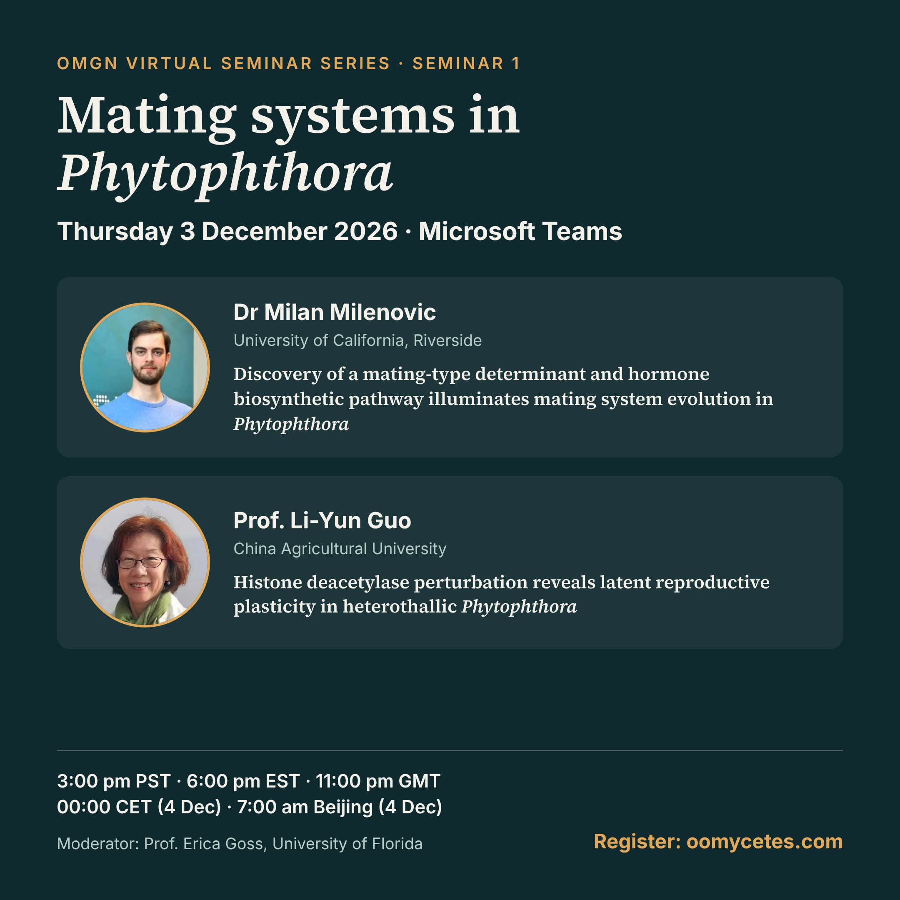

  📢
  
    This page is open to anyone who wishes to share news,
    events, opportunities, or other information with
    the OMGN community.
  

## OMGN Virtual Seminar Series

### Seminar 1 — Mating systems in *Phytophthora*

**Thursday 3 December 2026 · Online via Microsoft Teams**

The Oomycete Molecular Genetics Network is delighted to
launch its **Virtual Seminar Series**, bringing together
researchers from around the world to share discoveries
and foster scientific exchange.

Our inaugural seminar features **Dr Milan Milenovic**
(University of California, Riverside) and **Prof. Li-Yun Guo**
(China Agricultural University), exploring mating-type
determination, hormone biosynthesis, and reproductive
plasticity in *Phytophthora*.

**Moderator:** Prof. Erica Goss, University of Florida.

**Schedule:** 3:00 pm PST · 6:00 pm EST · 11:00 pm GMT  
00:00 CET (4 December) · 7:00 am Beijing (4 December)

**Format:** Two 20-minute presentations, each followed
by 10 minutes of questions.

**Free registration — Open to everyone!**

[**Register for the seminar →**](https://events.teams.microsoft.com/event/41eae796-1ef7-4b44-99b2-3dd4d5caae97@0d4da0f8-4a31-4d76-ace6-0a62331e1b84)

The Microsoft Teams joining link will be emailed
to registered participants.

---

